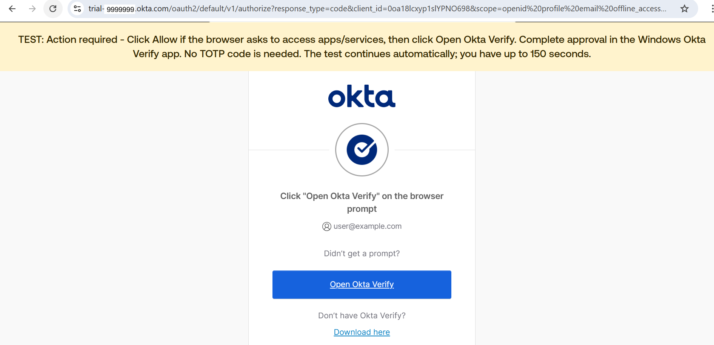
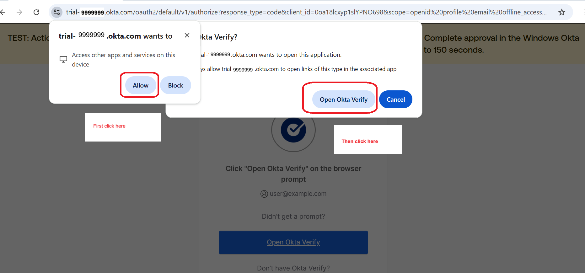
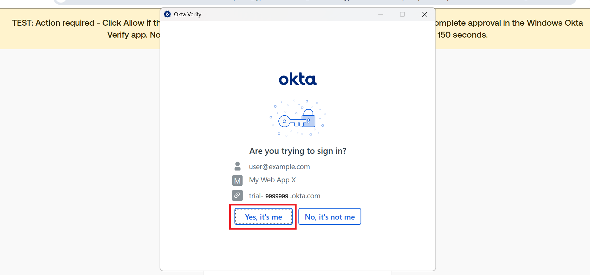

# E2E Test Notes — swagger-bff-login.spec.ts

Learning reference for the Playwright patterns used in this test.

---

## Files at a glance

| File | Purpose |
|---|---|
| `tests/swagger-bff-login.spec.ts` | The only test — full login flow |
| `playwright.config.ts` | Global Playwright configuration |
| `package.json` | npm scripts (`test`, `test:headed`, `codegen`) |

---

## playwright.config.ts — Key settings explained

```ts
timeout: 3 * 60 * 1000   // 3-minute per-test timeout
```
The test allows time for the user to approve an Okta Verify FastPass prompt. The default (30 s) could time out.

```ts
fullyParallel: false
workers: 1
retries: 0
```
One browser, one test, no retries. MFA flows can't be parallelised, and retrying after a failed login could hit Okta lockout.

```ts
headless: false
```
The browser must be visible so you can follow any Okta FastPass prompts. Approve the sign-in on the enrolled device when requested.

```ts
trace: 'on-first-retry'
```
Records a Playwright trace (screenshots + DOM snapshots + network) on the first retry — useful for debugging failures without changing the test.

```ts
baseURL: process.env.SWAGGER_UI_URL ?? 'http://localhost:8081'
```
`baseURL` makes relative paths like `/swagger-ui/index.html` work. The test overrides it with a full URL anyway (`page.goto(APP_URL)`), but it's good practice and is used by the `playwright test --ui` viewer.

```ts
navigationTimeout: 30_000
actionTimeout: 15_000
```
`actionTimeout` is the default for `click`, `fill`, `waitForSelector` etc. `navigationTimeout` is the default for `page.goto` and `page.waitForURL`.

---

## Environment variables

| Env var | Maven `-D` flag | Default | Required |
|---|---|---|---|
| `SWAGGER_UI_URL` | `-Dswagger.e2e.url` | `http://localhost:8081` | No |
| `TEST_USER_EMAIL` | `-Dokta.test.user.email` | — | **Yes** |
| `TEST_USER_PASSWORD` | `-Dokta.test.user.password` | — | **Yes** |
| `OKTA_TENANT_ID` | `-Dokta.tenant.id` | — | **Yes** |

The test throws immediately (before any browser is opened) if the three required vars are missing:

```ts
if (!TEST_USER_EMAIL || !TEST_USER_PASSWORD || !OKTA_TENANT_ID) {
  throw new Error('Missing required env vars ...');
}
```

**Why throw at module level rather than inside the test?**  
Throwing at module level means Playwright reports a configuration error, not a test failure. It's clearer and saves time — no browser is opened needlessly.

```ts
const OKTA_DOMAIN = new RegExp(`${OKTA_TENANT_ID}\.okta\.com`);
```
A regex is built from the tenant ID so `waitForURL` can match any path under the Okta domain (e.g. `integrator-4588018.okta.com/login/...`). Used in step 3.

---

## Test flow — step by step

### Step 1 — Open Swagger UI

```ts
await page.goto(APP_URL);
await page.waitForSelector('.swagger-ui .info', { timeout: 15_000 });
```

`page.goto` navigates to the URL and waits for the network to go idle.  
`waitForSelector` then waits until the `.swagger-ui .info` element is in the DOM — that's the title block rendered by SwaggerUI after the bundle finishes parsing the OpenAPI spec. Without this wait, clicking Authorize could happen before the button is mounted.

**Selector pattern:** `.swagger-ui .info` — CSS class chaining, scoped to the `.swagger-ui` root to avoid collisions with other elements on the page.

---

### Step 2 — Click Authorize

```ts
await page.click('button.btn.authorize');
```

Targets the top-level Authorize button (not the per-operation lock icons). In the BFF extension, clicking this triggers `http-auth.jsx`, which detects `redirectforlogin: true` and fires `window.location.href` after a 50 ms timer. The navigation away from Swagger UI starts automatically — no need to interact with any dialog.

**Why no `waitForSelector` before the click?**  
Because `waitForSelector('.swagger-ui .info')` already ensures the full SwaggerUI bundle has rendered, which includes the Authorize button.

---

### Step 3 — Wait for redirect to Okta

```ts
await page.waitForURL(OKTA_DOMAIN, { timeout: 15_000 });
```

`waitForURL` blocks until the current URL matches the given string or regex. Using the regex `OKTA_DOMAIN` (built from `OKTA_TENANT_ID`) makes the assertion tenant-agnostic — works for both `trial-*` and `integrator-*` tenants.

**Why not `waitForNavigation`?**  
`waitForNavigation` is deprecated in Playwright. `waitForURL` is the modern replacement and is more explicit about what URL you expect to land on.

---

### Step 4 — Okta username screen

```ts
await page.waitForSelector('input[name="identifier"]', { timeout: 15_000 });
await page.fill('input[name="identifier"]', TEST_USER_EMAIL);
await page.click('[data-se="o-form-input-submit"], input[type="submit"]');
```

**`input[name="identifier"]`** — Okta's username field always uses `name="identifier"`. More stable than selecting by placeholder text or label (which can change with locale or Okta version).

**`page.fill`** — clears the field first, then types the value. Better than `page.type` (which appends) when the field might have a default value.

**`[data-se="o-form-input-submit"], input[type="submit"]`** — A CSS selector with a comma (OR). The primary target is the Okta `data-se` attribute (more stable); `input[type="submit"]` is the fallback for older Okta org styles.

---

### Step 5 — Select Okta Verify FastPass

```ts
const fastPassOption = page.getByRole('link', { name: 'Select Okta Verify.' });
await expect(fastPassOption).toBeVisible({ timeout: 15_000 });
await fastPassOption.click();
```

The currently observed Okta method screen offers Password and "Use Okta FastPass". Select the Okta Verify link by its accessible name.

The test attaches the page DOM after selecting FastPass to its Playwright output under the ignored `test-results` directory. Review that artifact if Okta shows a new screen; the first-time setup and returning-user routes should be handled based on screens observed during actual runs.

### Step 6 — Approve FastPass

Approve the request on the enrolled device if Okta prompts for it. The test waits for either the callback to Swagger UI or an Okta password field. If neither appears, Playwright's failure snapshot and attached DOM show the screen that needs handling next.

Before selecting FastPass, the test prints an ACTION REQUIRED banner in the terminal/Maven output. If Chrome asks for access to apps/services on the device, click **Allow**, then click **Open Okta Verify** on its application prompt. Complete any approval in the Windows Okta Verify app. These browser-native prompts are handled manually, not through page selectors. No TOTP code is needed.

The test also inserts a yellow, full-width instruction banner at the top of the Okta page, using the same layout as the existing session-status banner. It does not intercept clicks and disappears on full-page navigation. Browser-native prompts may temporarily dim or cover the page banner.

#### Manual interaction — screenshots in order

**1. First, the instruction banner appears.** The test is waiting for you to complete FastPass approval; no TOTP code is needed.



**2. Next, the browser popups appear.** First click **Allow** to permit access to apps and services on this device, then click **Open Okta Verify** to launch the Windows app.



**3. Lastly, the Okta Verify confirmation appears.** Confirm that the account, application, and tenant match the sign-in you just initiated, then click **Yes, it's me**.



**After this approval, the password screen appears and password entry is automated.** The test fills and submits the configured test-user password; you do not need to type it. The rest of the flow is also automated: return to Swagger UI, verification of the authenticated session and secured endpoint, logout, and verification that access is removed.

```ts
await page.waitForFunction((appOrigin) => {
  const app = new URL(appOrigin);
  return (location.origin === app.origin && location.pathname.includes('/swagger-ui')) ||
    document.querySelector('input[name="credentials.passcode"]') !== null;
}, APP_ORIGIN, { timeout: 150_000 });
```

If Okta requests the account password after FastPass approval, Playwright fills `input[name="credentials.passcode"]` and submits it. Otherwise it continues after returning to Swagger UI.

---

### Step 8 — Wait for redirect back to Swagger UI

```ts
await page.waitForURL(/localhost:8081.*swagger-ui/, { timeout: 30_000 });
```

After the OAuth2 callback, Spring Security redirects to `/swagger-ui/index.html`. The regex matches any URL on port 8081 that contains `swagger-ui`, making it tolerant of query strings or hash fragments.

---

### Step 9 — Assertions after login

#### Padlock locked

```ts
await expect(page.locator('button.btn.authorize.locked').first()).toBeVisible({ timeout: 30_000 });
```

`page.locator` returns a locator object — it doesn't query the DOM yet. `toBeVisible()` is the assertion that actually waits and checks.

`button.btn.authorize.locked` — SwaggerUI adds the `locked` CSS class to the Authorize button when at least one security scheme has been authorized. The BFF extension calls `authActions.authorize()` after it receives a valid `/shortprofile` response.

`.first()` — there may be multiple Authorize buttons on the page (one global, one per operation). Any of them being locked is sufficient.

**Why `{ timeout: 30_000 }`?**  
The BFF extension makes a `/shortprofile` XHR after the redirect lands. There's a brief async gap before `authActions.authorize()` is called. The extra timeout absorbs that delay.

#### /shortprofile API check

```ts
const profileResponse = await page.request.get(`${BFF_ORIGIN}/shortprofile`);
expect(profileResponse.status()).toBe(200);
const profile = await profileResponse.json();
expect(profile).toMatchObject({ loggedIn: true });
expect(typeof profile.name).toBe('string');
expect(profile.name.length).toBeGreaterThan(0);
```

`page.request.get` sends an HTTP request **from within the browser context** — it uses the same cookies/session as the browser tab. This is how the BFF session cookie is included automatically.

`toMatchObject({ loggedIn: true })` — partial object match. The response may have other fields (`name`, `email`, etc.); `toMatchObject` only checks that the specified keys match, ignoring extras.

Checking `profile.name` is a string with length > 0 confirms the BFF returned real user data from Okta, not just a stub `{ loggedIn: true }`.

---

### Step 10 — Assert /secured/user returns 200 while logged in

```ts
const securedResponse = await page.request.get(`${BFF_ORIGIN}/secured/user`);
expect(securedResponse.status()).toBe(200);
expect(await securedResponse.text()).toBe('ok');
```

This is a **direct HTTP call** from within the browser context (same session cookie), not a click through Swagger UI. That is intentional — the claim under test is that the BFF session cookie works for a protected endpoint, not that Swagger UI's "Try it out" button works.

`/secured/user` requires `ROLE_myuser`. The test user (`user@example.com`) is in the `myuser` Okta group, which maps to `ROLE_myuser` in Spring Security. The endpoint simply returns the plain text string `"ok"` on success.

A green DOM banner is also injected into the page for 4 seconds so you can see the result visually before logout begins:

```ts
await page.evaluate(() => {
  const banner = document.createElement('div');
  banner.textContent = '✅ /secured/user → 200 OK  —  session is active. Proceeding to logout...';
  banner.style.cssText = 'position:fixed;top:0;left:0;width:100%;...';
  document.body.appendChild(banner);
});
await page.waitForTimeout(4_000);
```

`page.evaluate` runs JavaScript directly in the browser tab. The banner is a regular DOM element — no dialog, no Playwright-managed popup. It disappears naturally when the next navigation wipes the page.

> **Note:** The banner is currently not visible during the test — under investigation. It doesn't affect test correctness.

---

### Step 11 — Logout via /apilogout?source=swagger

```ts
await page.goto(`${BFF_ORIGIN}/apilogout?source=swagger`);
await page.waitForURL(/swagger-ui/, { timeout: 30_000 });
```

`/apilogout` is a BFF endpoint that:
1. Clears the Spring Security context and invalidates the `JSESSIONID` session
2. Redirects to Okta's `/v1/logout` with `id_token_hint` and `post_logout_redirect_uri`
3. Okta performs its side of the logout and redirects back to Swagger UI

The `?source=swagger` parameter tells the BFF to use the Swagger UI URL as the `post_logout_redirect_uri` rather than the Angular frontend URL.

`waitForURL(/swagger-ui/)` waits for the full round-trip (BFF → Okta → back to Swagger UI) to complete.

---

### Step 12 — Assert padlock is unlocked after logout

```ts
await expect(page.locator('button.btn.authorize:not(.locked)').first()).toBeVisible({ timeout: 15_000 });
```

`:not(.locked)` explicitly asserts the unlocked state — cleaner than just checking the button exists. After logout the BFF extension calls `/shortprofile`, receives `{ loggedIn: false }`, and calls `authActions.logout()` which removes the `locked` CSS class.

---

### Step 13 — Assert /shortprofile returns { loggedIn: false } after logout

```ts
const profileAfterLogout = await page.request.get(`${BFF_ORIGIN}/shortprofile`);
expect(profileAfterLogout.status()).toBe(200);
const profileDataAfter = await profileAfterLogout.json();
expect(profileDataAfter).toMatchObject({ loggedIn: false });
```

`/shortprofile` returns 200 with `{ loggedIn: false }` even for unauthenticated users (it doesn't require authentication). This is intentional — it's used by the BFF extension on every page load to decide whether to lock or unlock the padlock.

---

### Step 14 — Assert /secured/user returns 401 after logout

```ts
const securedAfterLogout = await page.request.get(`${BFF_ORIGIN}/secured/user`);
expect(securedAfterLogout.status()).toBe(401);
```

The session is gone so there's no `JSESSIONID` cookie (or it's invalidated). Spring Security's custom `authenticationEntryPoint` returns HTTP 401 for API calls rather than redirecting to a login page. This is the expected behaviour for a BFF serving an SPA — the frontend handles the 401, not the server.

**Why not a redirect (302)?**  
The default Spring Security behaviour for unauthenticated requests is to redirect to `/login`. The BFF explicitly overrides this with a 401 so that the Swagger UI extension (and Angular frontend) can detect the unauthenticated state programmatically.

---

### Step 15 — Final visual pause

```ts
await page.waitForTimeout(5_000);
```

Keeps the browser open for 5 seconds after all assertions pass so you can see the final post-logout state (unlocked padlock) before the browser closes.

---

## Common Playwright patterns used here

| Pattern | Example in this test | Why |
|---|---|---|
| `waitForSelector` before interaction | Every Okta screen | SPA transitions don't reload the page — must wait for DOM |
| `fill` over `type` | All form inputs | `fill` clears first; `type` appends |
| `data-se` attribute selectors | Okta buttons/inputs | More stable than text or class selectors |
| Comma in selector (OR) | Submit button | Primary + fallback selector in one call |
| `waitForURL` regex | Okta redirect, callback, logout | Matches any path under a domain |
| `page.request.get` | `/shortprofile`, `/secured/user` | Reuses browser session cookies for API calls |
| `toMatchObject` | Profile response | Partial match — tolerant of extra fields |
| Module-level throw for missing env vars | Top of file | Fail fast before browser opens |
| `:not(.locked)` selector | Padlock after logout | Explicit unlocked assertion, not just presence |
| `page.evaluate` | DOM banner injection | Run JS in browser tab to show visual feedback |
| `waitForTimeout` | After banner, after final assertion | Visual pause so you can observe state |
